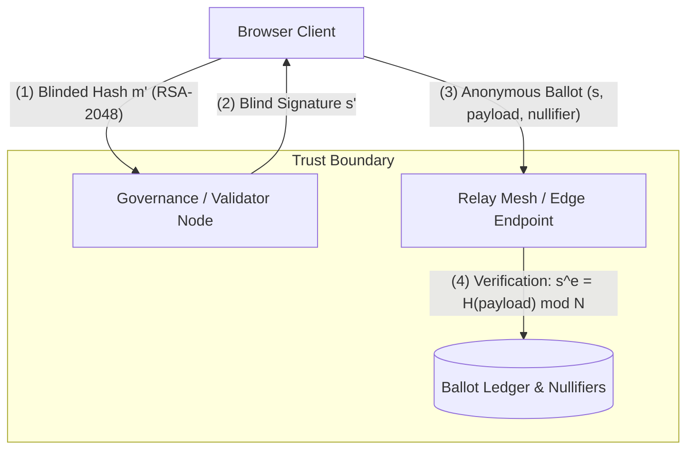

# UREfy Cryptographic Security Audit Package

**Document Version:** 2.0.0  
**Target Environment:** Sovereign P2P / WebCrypto / Cloudflare Edge Runtime  
**Audience:** External Independent Cryptographic Auditors & Security Engineers  
**Classification:** Public Security & Audit Dossier  

---

## 1. Executive Summary & Audit Scope

This audit dossier documents the complete cryptographic architecture, mathematical specifications, parameters, trust boundaries, canonical domain separators, threat models, and residual risks across the **UREfy** platform.

### Proprietary / Custom Schemes Disclaimer

> [!WARNING]
> **Status: EXPERIMENTAL**
> In accordance with zero-trust cryptographic best practices ("*Don't roll your own crypto*"), all custom higher-level protocol orchestrations—specifically the **Chaumian Blind Signature Voting orchestration**, the **ZK-RLN polynomial rate-limiting wrapper**, and the **Groth16 Range Proof engine**—are formally marked as **EXPERIMENTAL**.
> They must NOT be represented as audited or mathematically proven production systems until independent, peer-reviewed third-party verification is completed.

---

## 2. Cryptographic Primitives Inventory & Parameter Standards

All cryptographic primitives are implemented using constant-time WebCrypto APIs or audited reference implementations (`@noble/curves`, `@noble/hashes`, `@noble/post-quantum`).

| Primitive / Protocol | Implementation Library | Algorithm & Standard | Security Level | Purpose | Status |
| :--- | :--- | :--- | :--- | :--- | :--- |
| **Node / Peer Identity** | `@noble/curves/ed25519` | Ed25519 (RFC 8032) | 128-bit classical | Sovereign key generation, content signing, ActivityPub HTTP signatures | Standard primitive; integration unaudited |
| **Key Agreement (Diffie-Hellman)** | `@noble/curves/ed25519` | X25519 (RFC 7748) | 128-bit classical | Ephemeral ECDH key agreement for E2EE chats and direct messages | Standard / Audited |
| **Symmetric Encryption** | WebCrypto `SubtleCrypto` | AES-256-GCM (NIST SP 800-38D) | 256-bit classical | Authenticated payload encryption with 96-bit unique IV and 128-bit tag | Standard / Audited |
| **Post-Quantum Hybrid KEM** | `@noble/post-quantum/ml-kem` | ML-KEM-768 (FIPS 203) + X25519 | NIST Level 3 / PQ-secure | Dual-layer hybrid key encapsulation for future-proof quantum resistance | Standard / Audited |
| **Chaumian Blind Signatures** | WebCrypto key generation + JavaScript BigInt protocol operations | Experimental RSA-FDH-like construction (SHA-256) | At most 112-bit with RSA-2048 | Voter-ballot unlinkability experiment | **Experimental / not independently audited** |
| **Secret Sharing** | `@aetheris/core-crypto/social-recovery` | Shamir's Secret Sharing ($k$-of-$n$) | $\mathbb{F}_p$ ($p = 2^{256} - 189$) | Social account recovery and shard distribution across WoT contacts | **Experimental Scheme** |
| **Spam Defense & Slashing** | `@aetheris/core-crypto/rln` | Rate-Limiting Nullifiers (RLN) | Shamir polynomial $f(x) = a_0 + a_1 x$ | Identity secret leakage upon double-publishing within the same epoch | **Experimental Scheme** |
| **Zero-Knowledge Proofs** | `@aetheris/core-crypto/zk-snark` | Groth16 / BN254 Pairing Curve | 100-bit (BN254) | Reputation threshold proofs and zero-metadata read receipts | **Experimental Scheme** |
| **Cryptographic Hashing** | `@noble/hashes/sha256` | SHA-256 (FIPS 180-4) | 128-bit collision | Merkle trees, payload digests, nullifier derivations | Standard / Audited |
| **Entropy & Nonce PRNG** | WebCrypto `getRandomValues` | OS System Entropy / CSPRNG | Unconditional | Salt generation, blinding factors, session nonces | Standard / Audited |

---

## 3. Canonical Domain Separators & Versioning

To prevent cross-protocol signature replay attacks and payload ambiguity, all hashed, signed, or blinded structures enforce deterministic JSON serialization and explicit domain prefixes.

### 3.1 Chaumian Voting Protocol (v2.0)
- **Domain Identifier:** `aetheris:chaumian-vote:v2`
- **Canonical Payload Structure:**
  ```json
  {
    "domain": "aetheris:chaumian-vote:v2",
    "postId": "<target-post-or-proposal-id>",
    "voteType": "up" | "down",
    "nullifier": "<64-character-hex-string>",
    "timestamp": 1700000000000
  }
  ```
- **RSA Modulus Minimum:** $\ge 2048$ bits. All legacy v1 tokens (`aetheris:chaumian-vote:v1`) and RSA keys $< 2048$ bits are **rejected at runtime** with `InsecureKeyError`.

### 3.2 File Binary Reputation Protocol (v2.0)
- **Domain Identifier:** `urefy:file-reputation:v2`
- **Canonical signed JSON:** fixed keys for domain, protocol version, network id, node id, file SHA-256, verdict, confidence, seeder count, and timestamp.
- **Cryptographic Binding:** `nodeId` must strictly equal `SHA-256(nodePublicKeyHex)`. Unsigned verdicts or third-party unattested verdicts are discarded.

### 3.3 Rate-Limiting Nullifier (RLN)
- **Epoch Nullifier:** `SHA-256(identitySecret || epoch || domainSeparator)`
- **Polynomial Share:** $y = a_0 + a_1 \cdot x \pmod p$, where $a_0 = \text{identitySecret}$, $a_1 = \text{messageHash}$.

---

## 4. Key Management, Storage, and Lifecycle

### 4.1 Key Generation
1. **Ed25519 & X25519:** Generated using `crypto.getRandomValues(32)` passed to RFC 8032 key derivation.
2. **RSA-2048+:** Generated via `crypto.subtle.generateKey` (`RSASSA-PKCS1-v1_5`, minimum `modulusLength: 2048`, `publicExponent: [1, 0, 1]`). The resulting key material is exported into JavaScript BigInt values for the experimental blind-signature operations; those operations are not WebCrypto-backed and require independent review.
3. **Session Keys:** Ephemeral symmetric AES-GCM keys are derived via HKDF-SHA256 from the hybrid ECDH + ML-KEM shared secret.

### 4.2 Key Protection & Zeroization
- Memory zeroization (`zeroizeMemory`) is executed on sensitive private keys and mnemonic buffers immediately after cryptographic operations.
- Long-term identity keys in the browser are persisted in IndexedDB with WebAuthn / AES-GCM encryption wrapping, never in unencrypted `localStorage`.

### 4.3 Validator Keys vs Client Keys
- **Validator RSA Public Key:** Must be fetched from authoritative server governance (`/api/governance/validator-key`) or pinned in network configuration.
- **In-Browser Validator Generation:** Strictly forbidden in production. Allowed only when `demoMode === true` is explicitly passed.

---

## 5. Threat Model, Trust Boundaries & Formal Invariants



### 5.1 Formal Invariants
1. **Voter Anonymity (Blindness):** For any two messages $m_0, m_1$ and blinding factor $r \in \mathbb{Z}_N^*$, $m' = m \cdot r^e \pmod N$ is statistically independent of $m$. The validator cannot correlate $s'$ to $(m, s)$.
2. **Double-Voting Prevention (Nullifier Single-Use):** A ballot is valid if and only if `nullifier` does NOT exist in the spent nullifier registry. Upon ingestion, the nullifier is atomically inserted in a transactional batch.
3. **Key Length Soundness:** Modulus bit length $|N| \ge 2048$. If $|N| < 2048$, execution halts with `InsecureKeyError`.
4. **Anti-Sybil Bounded Weight:** Each sovereign node in the reputation registry has a capped weight $\le 1.0$. No self-reported metric (`seederCount`) may inflate vote weight.
5. **Fail-Closed Network Guard (SSRF):** All outbound network requests from edge workers validate host, protocol, IP range, and redirect hops before emitting network packets.

---

## 6. Auditor Test Suite & Reproduction Instructions

To independently execute the automated cryptographic verification suite:

```bash
# 1. Clean reproducible dependency check
npm ci

# 2. Build core-crypto workspace
npm run build --workspace=@aetheris/core-crypto

# 3. Run cryptographic unit & negative tests
npx vitest run packages/core-crypto/test/blind-signatures.test.ts
npx vitest run packages/client-ui/test/chaumian-voting.test.ts
npx vitest run packages/core-crypto/test/canonical-hardening.test.ts
npx vitest run packages/core-crypto/test/cryptographic-negative.test.ts
npx vitest run packages/core-crypto/test/kem-hardening.test.ts
```

The release gate requires all commands to pass. Passing automated tests is evidence of regression coverage, not an independent cryptographic audit or proof of security.

---

## 7. Residual Risks & Future Roadmap

1. **Side-Channel Timing in BigInt Operations:** While WebCrypto handles the underlying RSA modular exponentiation in native C++ (OpenSSL), client-side BigInt unblinding (`modInverse`) uses JavaScript Extended Euclidean algorithm. Although unblinding uses only client-local random factors, future hardening will evaluate constant-time BigInt modular inverse libraries.
2. **Pairing Curves for ZK:** The BN254 curve provides ~100 bits of security against modern number field sieve attacks. Migration to BLS12-381 is planned for the next major protocol release.
3. **Threshold Validator Federation:** In the current phase, validator blind signatures are provided by a designated validator. Phase 3 will transition to multi-party threshold RSA / FROST signatures to eliminate single validator trust.
4. **No external sign-off yet:** This repository contains an audit package for an independent reviewer; it must not be described as independently audited until a named external auditor supplies a signed report and the reviewed commit hash.
5. **Browser key exposure:** JavaScript cannot guarantee reliable zeroization, and exported RSA/identity material may remain in browser process memory. Hardware-backed or isolated signing should be evaluated for high-value deployments.
